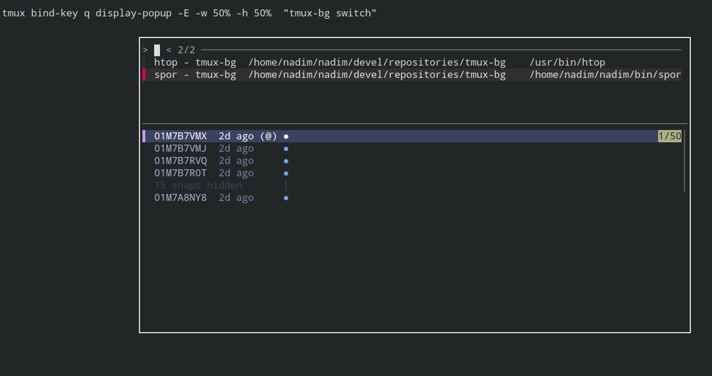

# tmux-bg

Run terminal programs in the background of tmux and jump to them from
anywhere. `tmux-bg run vim` starts vim in a detached window of a dedicated
manager session; from any session, a single key binding opens an fzf picker
(inside a tmux popup when needed) and switches to the window you want.
One manager session keeps all of your background programs together, no
matter which session you started them from. The session is created
automatically when the first program is launched, and launches never move
your current client.



## Features

- **Background programs** — start a program detached and keep working;
  switch to it later with one keypress.
- **fzf picker in a popup** — works from key bindings: the script opens
  its own popup (with configurable size) when it needs a terminal.
- **Instance identity** — one window per executable + working directory;
  arguments never spawn duplicate instances.
- **Aliases** — `tmux-bg v todo` works when `v` is an alias for `vim`
  (resolved from your interactive shell's rc files).
- **Keep window on exit** — a finished program's window stays open, so
  its output remains visible (`run ls` works); `clean-up` removes it.
- **Failure visibility** — a program that dies immediately shows its
  error as a tmux message instead of failing silently.

## Requirements

- Bash 4+
- tmux 3.2 or newer (the picker uses `display-popup`; recent versions
  also report a dead pane's exit status for nicer error messages)
- fzf (only for `switch` and `kill`)
- GNU `readlink -f` (the intended platform is Linux)

## Install

```sh
mkdir -p ~/.local/bin
cp tmux-bg ~/.local/bin/
chmod +x ~/.local/bin/tmux-bg
```

Make sure `~/.local/bin` is on your `PATH`.

## Quick start

```sh
tmux-bg run vim                 # start vim in the background
tmux-bg run v todo.md           # aliases work: v may expand to vim
tmux-bg run ls                  # quick commands too; the window keeps their output
tmux-bg run --attach htop       # start and switch to it right away
tmux-bg --session dev-tools run lazygit   # use a different manager session
tmux-bg switch                  # pick a program with fzf
tmux-bg kill                    # pick one or more programs to kill
tmux-bg list                    # see what is managed
tmux-bg clean-up                # remove windows whose program exited
```

## Key bindings

The script opens its own popup when it runs from a binding without a
terminal (`run-shell`), so both bindings can be plain `run-shell`. The
popup size is passed to `tmux-bg` as options, which means each binding
can use its own geometry:

```tmux
# ~/.tmux.conf
bind-key P run-shell "tmux-bg --popup-width 95% --popup-height 90% switch"
bind-key K run-shell "tmux-bg --popup-width 90% --popup-height 80% kill"
```

Behavior of the picker:

- With a **single** managed program there is nothing to choose — the
  script switches directly, without opening fzf.
- When nothing is managed, nothing opens at all (no popup flicker):
  you get a short error on the status line instead.
- From **inside** the manager session, `switch` is a toggle and sends
  you back to the previous session.
- To pick **without** a popup, run `tmux-bg --no-popup switch` in a
  pane; fzf then draws inline in that terminal. Used where there is no
  terminal (e.g. a `run-shell` binding), it fails with a clear message.
- Old `display-popup`-style bindings keep working: the popup provides a
  terminal and the script detects it.

## Picker preview

Both pickers show the highlighted window's terminal contents via

```sh
tmux capture-pane -p -e -t WINDOW_ID
```

`-p` prints the captured content and `-e` preserves escape sequences for
terminal formatting. fzf refreshes the preview as the highlighted entry
changes: it is a refreshed snapshot, not a continuously streamed video.
The preview shows the window's active pane; it does not render an entire
multi-pane layout as one composite image.

## Commands

| Command                                             | Effect                                                                                                                   |
| ---                                                 | ---                                                                                                                      |
| `run [--attach] [--close-on-exit] PROGRAM [ARG...]` | Start PROGRAM detached in a managed window (see options below).                                                          |
| `switch`                                            | Pick a managed window with fzf and switch to it; toggle inside the manager session. Alias: `pick`.                       |
| `kill`                                              | Pick one or more managed windows  and kill them. Unmanaged windows in the session are not listed and never affected.     |
| `list`                                              | Print a table of managed windows (window id, program, directory).                                                        |
| `clean-up`                                          | Remove managed windows whose panes have exited. Alias: `cleanup`. Live programs and unmanaged windows are never touched. |

## Options

Global options (before the command):

| Option             | Effect                                                   |
| ---                | ---                                                      |
| `--session NAME`   | Use another manager session (default: `programs`).       |
| `--popup-width W`  | Picker popup width, cells or percent (default: `95%`).   |
| `--popup-height H` | Picker popup height, cells or percent (default: `90%`).  |
| `--no-popup`       | Never open a popup; pick inline in the current terminal. |
| `--attach`         | After starting or finding a program, switch to it.       |
| `-h, --help`       | Show the help (works outside tmux).                      |

`run`-specific options (after `run`):

| Option            | Effect                                                                |
| ---               | ---                                                                   |
| `--attach`        | Switch to the program after starting or finding it.                   |
| `--close-on-exit` | Close the window as soon as the program exits, instead of keeping it. |

## How instances are identified

`run` identifies a program by its **resolved executable path** plus the
**canonical current directory** — nothing else. Consequences:

- `run vim todo.md` and `run vim notes.md` in the same directory share
  **one** window; arguments do not create separate instances. When you
  call an existing instance with different arguments, they are ignored
  and `tmux-bg` tells you so.
- Two instances of the same program in different directories are two
  windows, by design.
- Aliases are resolved before this matching, so `v` and the `vim` it
  points to are the same instance.
- A window whose panes have all exited does not count as "already
  running": running it again starts a fresh instance.

Aliases are resolved through an interactive bash (`bash -ic 'type ...'`),
because aliases only exist in interactive shells. An alias like
`alias v='vim -o'` contributes `vim -o` to the command line.

Different programs can run in the same directory, and the same executable
can run in different directories — only the pair is unique. The identity is
stored in tmux window user options (see below), which are the source of
truth: the visible window title exists for humans and can be renamed
without breaking instance matching.

## Window lifecycle

- Managed windows set `remain-on-exit` at creation, so the window
  **stays open when the program exits** and its output stays readable.
  This is also why `run ls` works: the window survives long enough to
  be recorded and switched to.
- A program that dies immediately with a failing exit status raises a
  tmux status message with the pane's first output line, e.g.
  `tmux-bg: v exited immediately (exit 127): bash: v: command not found`.
  The window is kept for inspection.
- Programs are launched with `exec`, so the pane's main process becomes
  the requested program; killing the pane kills the program.
- `clean-up` removes the leftover windows (only when all panes have
  exited). Exit status 0 is not treated as an error and prints nothing.
- `--close-on-exit` restores the old ephemeral behavior for commands
  whose window is not worth keeping.

## Session layout

Programs live in the manager session (default name `programs`), one
window per instance. Each managed window carries tmux window options
that describe it:

| Window option        | Content                                          |
| ---                  | ---                                              |
| `@managed_program`   | Resolved executable path (instance identity).    |
| `@managed_directory` | Canonical working directory (instance identity). |
| `@managed_title`     | Window title, e.g. `vim - myproject`.            |
| `@managed_args`      | Arguments the instance was started with.         |
| `@managed_version`   | Bookkeeping schema version.                      |

Inspect them with `tmux show-options -wv -t <window> @managed_program`,
for example (window ID from `tmux list-windows -F '#{window_id}'`):

```sh
tmux set-option -w -t @3 @managed_program /usr/bin/nvim
tmux show-option -w -t @3 @managed_program
tmux show-options -w -t @3
tmux set-option -wu -t @3 @managed_program
```

These user options are runtime metadata held by the running tmux server,
not durable storage: they do not survive a complete server restart, so
after a restart tmux-bg no longer knows which windows it manages.

## Troubleshooting

```sh
tmux has-session -t '=programs'                        # does the session exist?
tmux list-windows -t '=programs' -F '#{window_id} #{window_name}'
tmux show-options -w -t @WINDOW_ID                     # metadata of one window
tmux-bg list                                           # what is managed
tmux-bg clean-up                                       # remove exited windows
command -v tmux fzf readlink                           # dependencies present?
```

A `session 'programs' does not exist` error before the first `run` is
normal; the session is created by the first launched program. Dead windows
from finished programs stay until `clean-up` removes them.

## Testing

`scripts/test_tmux_bg.sh` drives the real script against a fake `tmux`
binary that records every call (no live tmux needed), covering popup
geometry, the popup marker, `--no-popup`, alias resolution, instance
matching, keep/close-on-exit and the failure message:

```sh
bash scripts/test_tmux_bg.sh
```

## Notes and limitations

- Write shell compound commands as separate words:
  `tmux-bg run bash -c ls`. A whole command line quoted as a single
  word (`run 'bash -c "ls"'`) is not a program name and is rejected.
- Shell **functions** are not resolved, only PATH commands and aliases;
  alias values are word-split, so quoted multi-word arguments inside an
  alias may break apart.
- The script must run inside tmux (it checks `$TMUX`); `--help` is the
  only exception.
- Instance identity comes from the window metadata, not a process-tree
  scan: renaming windows is safe, but deleting the `@managed_*` options
  makes tmux-bg forget the instance.

